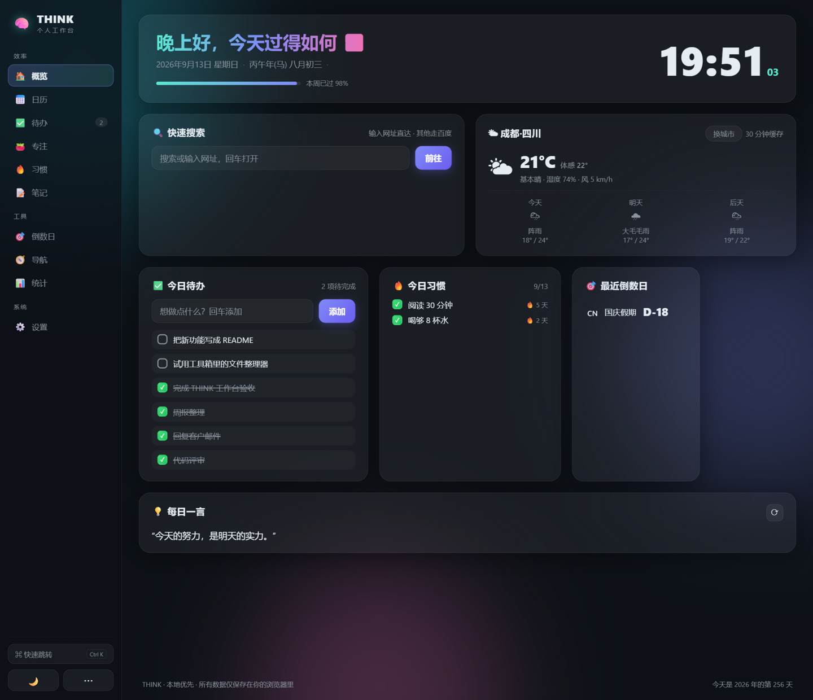
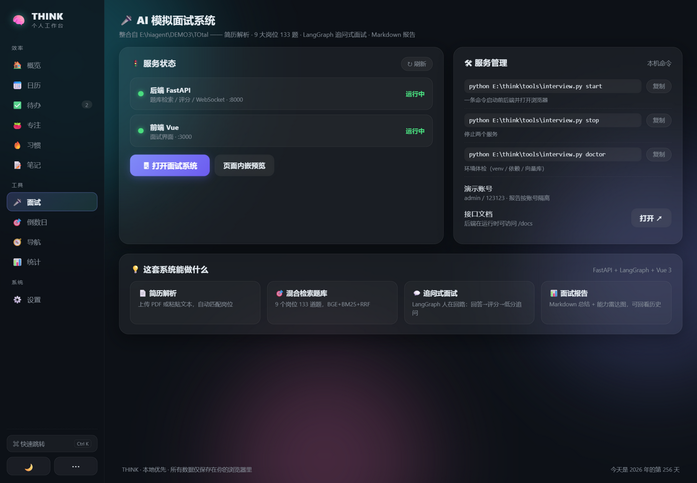

# 🧠 THINK · 个人效率套件

> 一个**双击即用**的本地优先个人工作台 + 一套**实测通过**的本地工具箱 + 已整合的 AI 模拟面试系统。
> 零框架、零构建、无需安装，所有数据只留在你自己的电脑上。



---

## 📦 目录结构

```
think/
├── app/                    # THINK 工作台 v2.1（侧边栏多页面应用）
│   ├── index.html          # ← 双击这个就能用
│   ├── style.css
│   └── js/                 # store 状态层 / main 路由核心 / views 11 个页面
├── tools/                  # Python 工具箱（7 个脚本 + 菜单入口）
│   ├── toolbox.py          # ← python toolbox.py 进入菜单
│   ├── interview.py        # AI 模拟面试系统启动/停止/体检/状态
│   ├── file_organizer.py   # 文件整理器
│   ├── folder_size.py      # 磁盘空间分析
│   ├── batch_rename.py     # 批量重命名
│   ├── password_generator.py
│   ├── image_tools.py      # 图片压缩/缩放/转格式（需 Pillow）
│   ├── pdf_tools.py        # PDF 合并/拆分/提取（需 pypdf）
│   └── requirements.txt
├── assets/                 # 各页面截图
└── README.md
```

## 🖥️ THINK 工作台 v2

**怎么用**：直接双击 `app/index.html`。v2 按功能拆成 10 个页面，左侧边栏切换（窄屏自动收成图标栏），`Ctrl+K` 呼出命令面板快速跳转。

| 页面 | 功能 |
|---|---|
| 🏠 **概览** | 实时时钟 + 农历干支 + 节日；**快速搜索**（网址直达 / 百度）；**实时天气**（Open-Meteo 免费接口，城市搜索、三天预报、30 分钟缓存，离线优雅降级）；今日待办速览、今日习惯速打卡、最近倒数日、每日一言 |
| 📅 **日历** | 月历公农历对照：每个格子显示农历日（初一显示月名）、自动标注法定/传统节日（春节、中秋、端午、教师节…），点选任意日期看详情（干支年、周数、距今天数） |
| ✅ **待办** | 回车添加、N 键聚焦、筛选、完成时间记录（供统计） |
| 🍅 **专注** | 番茄钟 25/5/15（**时长可自定义**）；按「结束时刻」计时——切页面、关浏览器再回来都不会乱；每 4 个自动建议长休息；合成提示音；**白噪音**（白噪音/棕噪音/雨声，纯 Web Audio 合成，切页不停）；标签页标题倒计时 |
| 🔥 **习惯** | 一周打卡网格、连续天数（今天没打不断签）、最多 8 个 |
| 📝 **笔记** | 多笔记笔记本：列表 + 编辑器双栏、搜索、置顶、停手半秒自动保存、字数统计、一键复制、导出 Markdown（旧单便签自动迁移为第一条） |
| 🔁 **复习** | 错题本 + SM-2 间隔重复：一键导入面试系统报告里的低分考点（含得分点对照），按「忘了/勉强/记得/轻松」排期，10 分钟→1 天→6 天→指数间隔；支持一键把「错题复习」加入习惯打卡 |
| 🎤 **面试** | **AI 模拟面试系统启动台**（整合自 `E:\hiagent\DEMO3\TOtal`）：前后端服务状态实时探测（绿点/灰点）、一键打开、页面内嵌预览、启动/停止/体检命令一键复制、演示账号提示。配套 `tools/interview.py` 一条命令管理整套服务 |
| 🎯 **倒数日** | 考试/假期/生日倒计时卡片墙，支持 emoji，自动按最近排序 |
| 🧭 **导航** | 常用网站书签墙：在线取站点图标，离线回退彩色首字母块 |
| 📊 **统计** | 今日/累计番茄、累计完成待办、最长连续打卡；**近 14 天专注柱状图**、近 7 天待办完成图、**GitHub 风习惯热力图**（最近 5 周） |
| ⚙️ **设置** | 主题切换、数据导出/导入/清空、关于与借鉴致谢 |

**隐私**：除天气（可选、可不用）与面试系统（本机服务）外完全不联网；数据存浏览器 localStorage 并**每 2 秒镜像一份到 IndexedDB**（localStorage 被清空时自动恢复），可随时导出 JSON 备份。**PWA**：通过 http 访问时自动注册 Service Worker，可安装到桌面离线使用；file:// 双击打开同样完整可用。

**想改就改**：无框架无构建，`js/views/` 一个文件一个页面，改哪看哪。

## 🧰 Python 工具箱

Python 3.8+，每脚本独立可用，或 `python tools/toolbox.py` 进菜单。
**改文件的操作默认只预览**，加 `--execute` 才执行。

```bash
python tools/file_organizer.py "D:/下载" --execute        # 按类型归档
python tools/folder_size.py "E:/" --depth 2 --top 10      # 空间分析
python tools/batch_rename.py "D:/照片" --number --prefix 旅行- --execute
python tools/password_generator.py --passphrase -w 4      # 口令短语
pip install -r tools/requirements.txt                     # 以下两个需要依赖
python tools/image_tools.py "D:/照片" --max-side 1920     # 压缩（原图自动备份）
python tools/pdf_tools.py merge a.pdf b.pdf -o 合并.pdf    # PDF 合并
```

## 🎤 AI 模拟面试系统（已整合）

来源：`E:\hiagent\DEMO3\TOtal`（FastAPI + LangGraph + Vue 3，JWT 登录、PDF 简历解析、追问式面试、Markdown 报告 + 能力雷达、语音输入与题目朗读）。**2026-09-13 起改为大模型应用开发专场**：仅保留「大模型应用开发工程师」岗位，其余 8 个岗位的 86 道题移入 `backend/data_disabled/`（恢复：移回 `data/` 并 `python main.py rebuild`）。

**v0.9 升级（本次实施）**：

| 升级项 | 说明 |
|---|---|
| 评分校准 | 评分提示词改为 **checklist 逐点核对**（每个得分点独立判定命中/未命中，完整性必须与命中比例一致）；同一回答**独立评分 3 次取中位数**（`SCORING_SAMPLES` 环境变量可调，1=关闭），得分点按过半采样归并 |
| 项目深挖模式 | WS config 传 `"mode":"project"`（需简历）：出题不再查题库，LLM 按简历项目经历生成递进式追问链（附参考答案与评分要点），失败自动回退题库检索 |
| 防背题变体 | `python main.py variants`（可选 `--count N`）：每个分类"换壳不换魂"生成变体题并自动重建，当前 47 → **56 题** |
| 会话持久化 | LangGraph checkpointer 从内存升级为 **SQLite**（`backend/checkpoints.db`），后端重启后未结束的面试可续接 |
| 登出吊销 | 新增 `POST /api/logout`，token 进入 SQLite 黑名单（users.db），REST 与 WS 均校验 |
| 错题闭环 | 新增 `GET /api/reports/{id}/weak-points` 低分考点接口 → THINK「复习」页一键导入 → SM-2 间隔复习 → 统计页**面试成长曲线**（5 场雷达叠加 + 均分趋势） |

**最简使用**（项目原件不动，THINK 只做整合与启动管理）：

```bash
python E:\think\tools\interview.py start    # 启动前后端并打开浏览器
# 登录 admin / 123123 → 上传简历或选岗位 → 开始面试 → 生成报告
python E:\think\tools\interview.py stop     # 用完停止
```

工作台侧边栏「🎤 面试」页提供：服务运行状态实时探测、一键打开、页面内嵌预览、常用命令复制。服务管理支持 `start / stop / status / doctor / open` 五个子命令，启动日志落在 `backend/server_8000.log` 与 `frontend/vite_3000.log`。

**端口冲突自动规避**：默认后端用 `:8000`；若它被其他程序占用（比如机器上的 `deepdossier serve`），`status` 会显示占用者身份，`start` 会自动把后端换到 `:8001/:8002` 并通过 `VITE_BACKEND_TARGET` 让前端代理指向新端口，两个项目互不干扰。`stop` 按命令行识别进程，只停本项目服务，绝不误杀别人的 python/node。




## 🙏 功能设计借鉴的优秀开源项目

v2 的功能规划先调研了 GitHub 上的同类头部项目，向它们致谢：

| 项目 | Stars | 借鉴点 |
|---|---|---|
| [glanceapp/glance](https://github.com/glanceapp/glance) | 37k | 多卡片聚合式概览布局 |
| [gethomepage/homepage](https://github.com/gethomepage/homepage) | 32.5k | 快速搜索、书签导航、天气与信息卡 |
| [lissy93/dashy](https://github.com/lissy93/dashy) | 26.4k | 书签卡片网格、多主题 |
| [super-productivity](https://github.com/super-productivity/super-productivity) | 22k | 番茄钟 × 待办 × 统计的结合、local-first 理念 |
| GitHub Contributions | — | 习惯热力图的形式 |

## 🧪 回归测试（2026-09-13 晚全量执行）

- **后端 pytest 套件：75 项全部通过**（含新增的评分中位数合并、角色回退、checklist 相关单测）。
- **THINK 前端回归**：12 个视图 + 命令面板 + 快捷键 + 导出/导入 + 数据恢复/彻底清空，逐项断言通过。
- 本轮又修掉 4 个真实缺陷：①「清空全部数据」被 IDB 镜像复活（根因：reload 前改 hash 触发的 render→save 回写）；②IDB 被阻塞时会卡死应用启动（加 onblocked + 1.5s 超时竞速）；③Service Worker 用 cache-first 导致代码更新永远进不来（改 network-first）；④`interview.py` 在 WMI 故障机上无法识别进程（改用 ctypes 查 exe 路径降级 + venv 基础解释器识别）。
- **机器级问题提示**：本机 WMI 服务当前处于"假死"状态（`sc query` 显示 RUNNING 但查询永久挂起），会影响 `tasklist`/PowerShell CIM/任何调用 `platform.machine()` 的程序。本次通过 `tools/run_tests.py`（启动前固定 platform 信息）绕过；**建议重启一次电脑**即可彻底恢复。

## ✅ 验证记录（全部当场实测）

- **工作台**：真实浏览器逐页操作——v1→v2→v2.1 数据自动迁移、11 个页面全部渲染无报错；日历农历/节日对表（9/10 教师节、9/25 中秋、10/1 国庆节均正确标注）；番茄钟到点自动结算并计入历史、跨页面计时连续、自动切换休息模式；白噪音启停；书签/倒数日/城市搜索增删；天气真实请求成功（成都 · 21°C · 三天预报）；命令面板跳转与主题切换执行成功；亮暗主题全页面可读。
- **笔记升级**：旧便签自动迁移为第一条笔记 ✓；新建/编辑/自动保存落盘 ✓；置顶排序 ✓；搜索过滤 ✓；字数与更新时间 ✓。
- **面试整合**：`interview.py` 完整走通 stop → status（双停）→ start（后端就绪 + 前端就绪 + 自动开浏览器）循环；`doctor` 五项检查全绿；`/api/roles` 返回 401（JWT 保护，符合预期）、前端 HTTP 200；工作台「面试」页状态探测与真实状态一致（运行中/运行中）；iframe 内嵌加载 Vue 前端成功。
- **工具箱**：沙盒真实文件全链路跑通（整理/重命名/分析/密码/图片/PDF），产物逐一复核，沙盒已清理。
- 全部 JS/Python 语法校验通过；本轮发现并修复 4 个真实 bug（Windows GBK 输出解码、tasklist PID 列解析、v1 浅合并覆盖新字段、后台标签页动画冻结导致内容透明）。

---

*由 ZCode 构建并验证 · 2026-09-13 · v2.1*
